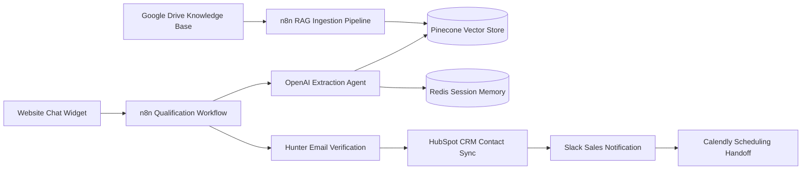
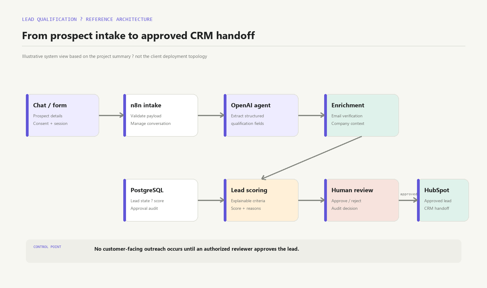

# AI Lead Qualification & CRM Enrichment Assistant

An AI-powered lead qualification and sales automation pipeline built with n8n. Combines a conversational website chat widget with document-grounded RAG retrieval, automated lead scoring, email verification, and CRM synchronization with human review.

> [!NOTE]
> **Implementation & Confidentiality Notice:**  
> This repository presents the architecture, sanitized n8n workflow templates, and client-facing chat interface for an automated lead-qualification and enrichment system originally developed for production use. In accordance with client NDAs, private API keys, proprietary CRM properties, and confidential sales data remain redacted.

---

## Video Walkthrough

Watch a comprehensive end-to-end walkthrough demonstrating chat interaction, n8n workflow execution, email verification, and CRM handoff:

📺 **[Watch the Product Walkthrough on Google Drive](https://drive.google.com/file/d/1U0eff06DoqX4AHfy9hmTER32MMZ-WVDF/view?usp=sharing)**

---

## System Architecture

### Core Pipeline Capabilities
* **Grounded Natural Conversations:** Uses OpenAI LLM connected to **Pinecone** to answer company and product FAQs from ingested documentation without hallucination.
* **Session Persistence:** Maintains multi-turn context across chat visits using **Redis** keyed by session ID.
* **Lead Scoring & Extraction:** Discretely extracts prospect budget, timeline, company size, decision-maker status, and email during natural dialogue.
* **Email Verification Gate:** Checks prospect email deliverability via **Hunter API** before any contact record creation to maintain clean CRM data.
* **CRM & Sales Operations:** Automatically upserts qualified leads to **HubSpot CRM**, posts instant deal notifications to **Slack**, and provides meeting booking handoffs via **Calendly**.

---

## Visual Architecture & Workflow Lifecycle

| High-Level Architecture | Lead Lifecycle Flow |
| :---: | :---: |
|  |  |

| End-to-End Demo Flow |
| :---: |
|  |

---

## Included Workflows

1. **`Lead_Qualifier.json` (Main Qualification & Routing):**
   * Webhook listener at `/lead-chat`.
   * Integrates OpenAI conversational agent, Pinecone retrieval, and Redis session memory.
   * Conditional routing: ongoing conversation, polite disqualification, or qualified prospect escalation through email verification, HubSpot, Slack, and Calendly.
2. **`Rag.json` (Automated Document Ingestion):**
   * Monitors Google Drive folder for new product / company documentation.
   * Splits text, generates embeddings (`text-embedding-3-large`), and indexes into Pinecone namespaces.
3. **`workflows/Lead_Review_Demo.json` (Human-in-the-Loop Review):**
   * Checkpoint workflow enabling sales reps to inspect lead enrichment and approve outreach before customer-facing emails dispatch.

---

## Tech Stack

* **Workflow Orchestration:** [n8n](https://n8n.io/)
* **AI & Embeddings:** OpenAI (`gpt-4o-mini` / `text-embedding-3-large`)
* **Vector Database:** Pinecone
* **Session Cache:** Redis
* **Sales & Ops Integrations:** HubSpot, Hunter, Slack, Calendly
* **Frontend:** Responsive Vanilla HTML, CSS, JavaScript widget

---

## Local Setup & Quickstart

1. Import `Lead_Qualifier.json` and `Rag.json` into your n8n workspace.
2. Configure credentials in n8n for OpenAI, Redis, Pinecone, Hunter, HubSpot, and Slack.
3. Activate the workflow and obtain your production `/lead-chat` webhook URL.
4. Update `CONFIG.webhookUrl` in `frontend/index.html` with your webhook endpoint.
5. Open `frontend/index.html` in your browser to test the interactive chat interface.

---

## Contact

**Meriem Neffeti**  
AI Automation Engineer  
Email: [neffetimeriem@gmail.com](mailto:neffetimeriem@gmail.com) · [LinkedIn](https://www.linkedin.com/in/meriem-neffeti-8a488a385/) · [GitHub](https://github.com/mariamneffeti)
