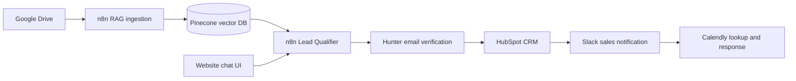

# AI Lead Qualification Assistant

An n8n-based assistant that answers company questions with RAG, qualifies inbound leads, validates email addresses, and routes qualified prospects to sales tools.

## Demo

Add a short product walkthrough GIF here:

## Screenshots

Add screenshots when available:

- Chat experience: `docs/screenshots/chat.png`
- n8n qualification workflow: `docs/screenshots/lead-qualifier-workflow.png`
- n8n ingestion workflow: `docs/screenshots/rag-workflow.png`

## Features

- **RAG ingestion:** Watches a Google Drive folder, downloads new files, loads document content, splits text, creates embeddings, and inserts vectors into Pinecone.
- **Conversational lead scoring:** Uses an AI agent and structured output to gather a prospect's email, company, budget, timeline, need, and decision-maker status, then classify the conversation.
- **Knowledge-grounded answers:** The agent can query the Pinecone vector store before returning to qualification questions.
- **CRM triggering:** Checks qualified email addresses with Hunter and creates or updates a HubSpot contact for deliverable addresses.
- **Sales notification and human review:** Sends qualified lead details to Slack for the sales team to review. The current workflow does not pause for an explicit approval before CRM actions.
- **Fallback handling:** Returns separate responses for ongoing conversations, unqualified leads, and emails that fail verification.
- **Conversation memory:** Uses Redis chat memory keyed by session ID.
- **Scheduling link lookup:** Calls Calendly after the Slack notification and includes the resulting step in the webhook response path.

## Architecture

## Stack

- **Automation/orchestration:** n8n
- **LLM:** OpenAI Chat Model (`gpt-5-mini` in the exported workflow)
- **Embeddings:** OpenAI `text-embedding-3-large` with 1024 dimensions
- **Vector database:** Pinecone
- **Conversation memory:** Redis
- **Lead verification and enrichment:** Hunter; additional enrichment can be connected as the workflow evolves
- **CRM and notification:** HubSpot and Slack
- **Scheduling:** Calendly API
- **UI hosting:** Static HTML; the demo UI can be hosted on Vercel

## Quickstart

1. Import `Rag.json` and `Lead_Qualifier.json` into your n8n instance.
2. Create and assign n8n credentials for Google Drive, Pinecone, OpenAI, Redis, Hunter, HubSpot, Slack, and Calendly as required by each workflow.
3. Review the Google Drive folder, Pinecone index and endpoint, Slack channel, and webhook settings for your environment.
4. Configure the Pinecone API key in n8n credentials. `Rag.json` currently contains an empty `Api-Key` header on its HTTP Request node; configure it before enabling ingestion.
5. Host `frontend/index.html` as a static page and set its webhook URL to the production webhook URL for the Lead Qualifier workflow.
6. Test both workflows with sample documents and leads, then activate them.

Do not commit API keys, tokens, or production webhook URLs. The `.env.example` file is informational; this project reads credentials from n8n rather than loading local environment variables.

## Workflows

### `Rag.json` — Google Drive ingestion

The Google Drive trigger polls a selected folder every minute for newly created files. The workflow downloads each file, sends a Pinecone HTTP request with a `fileId` filter, and sends the downloaded content through a binary document loader, recursive character text splitter, OpenAI embeddings, and Pinecone vector insertion. The data loader attaches the Drive file ID and filename as metadata.

The exported graph starts the filter request and the vector-store insertion as sibling paths after download. Confirm the Pinecone request semantics and execution ordering in your n8n environment before relying on replacement/deletion behavior for updated documents.

### `Lead_Qualifier.json` — chat qualification

The webhook accepts chat messages. The AI Agent uses Redis session memory, the OpenAI chat model, a structured output parser, and the Pinecone vector store as a knowledge tool. A Switch node routes the result:

- **Still gathering:** Return the assistant response to the chat client.
- **Qualified:** Send the extracted email to Hunter. If deliverable, create or update a HubSpot contact, notify the Slack channel, call Calendly, then respond to the webhook. If not deliverable, alert Slack and return an email-correction response.
- **Disqualified:** Return a polite fallback response.

## Key technical decisions

- **Why n8n:** The workflows make integrations, branching, and credential bindings inspectable and editable without a custom orchestration service.
- **RAG design:** Company documents are embedded and stored in Pinecone; the qualification agent retrieves company information through a vector-store tool rather than relying on model memory.
- **Structured output:** The output parser defines the fields needed by downstream routing and CRM actions.
- **Validation before CRM:** Hunter verification gates the HubSpot contact action to reduce invalid lead records.
- **Fallbacks:** Explicit routes keep gathering, disqualified, and undeliverable-email conversations from being treated as successful qualified leads.
- **Human-in-the-loop:** Slack provides sales visibility for qualified leads. An approval checkpoint is not currently wired into the automation.
- **Retries and resilience:** No explicit retry policy is configured in the exported workflow JSON. Configure n8n error workflows/retries and service-specific timeouts as appropriate when deploying.

## Results

Replace these placeholders with measured results from a real deployment:

- Leads processed: **TBD**
- Time saved per lead: **TBD**
- Cost reduction: **TBD**

## Roadmap

- Add an explicit human approval step before CRM writes.
- Add and document retry/error workflows for external service failures.
- Add automated evaluation cases for qualification quality and grounded answers.
- Capture deployment metrics for lead throughput, time saved, and operating cost.
- Add demo GIF and workflow screenshots.

## License

No license is currently specified in this repository. Add a `LICENSE` file to define reuse terms.

## Contact

Maintainer: **Add your name**  
GitHub: **Add your profile or repository link**  
Email: **Add your preferred contact email**
