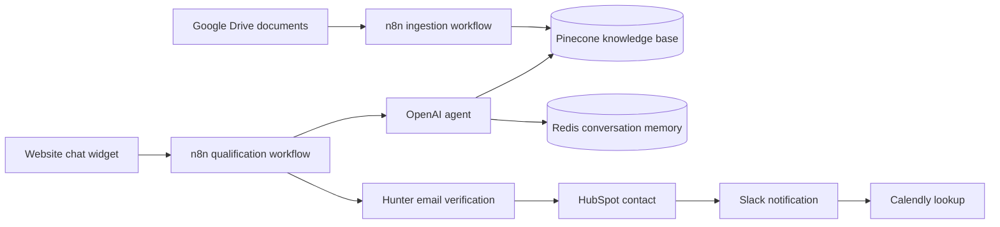

# AI Lead Qualification Assistant

An AI-powered lead qualification demo built with n8n. It combines a website chat interface with a conversational agent that answers company questions from a document knowledge base, gathers lead details, and routes qualified conversations through email verification and sales tools.

## Demo

[Watch the product walkthrough](https://drive.google.com/file/d/1U0eff06DoqX4AHfy9hmTER32MMZ-WVDF/view?usp=sharing).

## What it does

- Chats with prospective customers through a lightweight website widget.
- Uses an OpenAI model to gather a prospect’s business need, budget, timeline, decision-maker status, company, and email through a natural conversation.
- Retrieves company information from Pinecone so answers can be grounded in ingested documents.
- Keeps conversation context in Redis, keyed by the visitor’s session ID.
- Routes conversations as gathering, qualified, or disqualified.
- Checks qualified email addresses with Hunter before creating or updating a HubSpot contact.
- Sends sales notifications to Slack and looks up the Calendly account as part of the qualified-lead flow.

## Architecture

## Technology

- **Orchestration:** n8n
- **Chat model:** OpenAI `gpt-5-mini`
- **Embeddings:** OpenAI `text-embedding-3-large` with 1024 dimensions
- **Knowledge store:** Pinecone
- **Conversation memory:** Redis
- **Lead and sales integrations:** Hunter, HubSpot, Slack, and Calendly
- **Chat interface:** Static HTML, CSS, and JavaScript

## Workflows

### Lead qualification — `Lead_Qualifier.json`

The workflow accepts a chat message and session ID at the `/lead-chat` webhook. The AI agent uses Redis memory and the Pinecone vector store, then returns a structured result. Ongoing conversations get a chat reply; qualified leads go through Hunter email verification and, for deliverable addresses, the HubSpot, Slack, and Calendly steps; disqualified leads receive a polite response.

### Knowledge ingestion — `Rag.json`

The workflow watches a Google Drive folder for new files, downloads them, splits their content into chunks, creates embeddings, and inserts them into Pinecone with file metadata. The exported workflow also contains a Pinecone HTTP Request node with an empty API key and a project-specific endpoint, so that node must be configured for the target Pinecone project before ingestion is enabled.

## Run the demo

1. Import `Lead_Qualifier.json` into an n8n instance.
2. Configure n8n credentials for OpenAI, Redis, and Pinecone. The Pinecone index should use 1024-dimensional vectors to match the embedding configuration.
3. Configure Hunter, HubSpot, Slack, and Calendly credentials and account-specific selections if you want to demonstrate the qualified-lead path.
4. Activate the workflow and copy the production URL for its `/lead-chat` webhook.
5. In `frontend/index.html`, replace the `webhookUrl` value in the `CONFIG` object with that production webhook URL.
6. Host `frontend/index.html` as a static page, for example on Vercel, and open it to try the chat.

To demonstrate company-specific answers, import and configure `Rag.json`, provide Google Drive credentials, select a folder, configure the Pinecone HTTP Request node for your index, and ingest documents before testing the chat.

All service credentials belong in n8n’s Credentials settings. Do not put API keys or tokens in the frontend or commit them to the repository. The exported workflows contain account-specific settings that should be reviewed when connecting your own services.

## Implementation notes

- The qualification workflow sends the qualified lead to CRM after email verification. Slack provides sales visibility, but the workflow does not currently wait for a human approval before the CRM action.
- The exported workflows do not define explicit retry policies or error workflows.
- The RAG workflow’s Pinecone filter request and insertion paths should be reviewed in n8n before relying on document replacement or deletion behavior.
